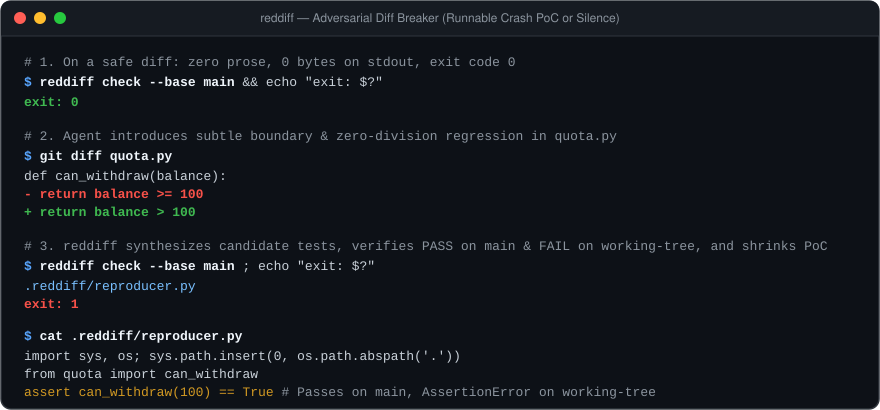

# reddiff

**Adversarial diff breaker with one rule: No review comment without a runnable crash PoC.**

[](https://github.com/abhinavm-web/reddiff/actions/workflows/ci.yml)
[](https://github.com/abhinavm-web/reddiff/releases)
[](LICENSE)
[](Cargo.toml)

<p align="center">
  
</p>

---

## Overview

Generating 2,000 lines of code with an AI takes 30 seconds; proving it doesn't introduce subtle regressions, off-by-one boundaries, division-by-zero panics, or broken state invariants takes hours.

Existing AI pull-request reviewers flood diffs with speculative prose comments (*"Consider checking if `x` could be null"*), false positives, and style nitpicks. Asking the same coding agent to write unit tests rarely catches the bug either—it writes happy-path tests that mirror the implementation's assumptions.

`reddiff` enforces a single design constraint:

> **Silence unless proven broken.** `reddiff` never outputs prose review comments. It only emits output when it synthesizes and verifies an executable reproducer script that **passes on the base git ref (`main` / `HEAD~1`)** and **fails on the target tree (`working-tree` / `HEAD`)**.

```text
  git diff (Base vs Target)
         |
         v
  +------------------------------------------+
  |         reddiff Adversarial Engine       |
  |  1. Parse unified diff & changed hunks   |
  |  2. Materialize isolated git worktrees   |
  |  3. Synthesize adversarial test harness  |
  |  4. Differential verification + shrink   |
  +------------------+-----------------------+
                     |
          +----------+----------+
          v                     v
    No Regression       Differential Failure Verified
   (0 bytes stdout,     (Writes minimal reproducer &
     exit code 0)        prints path + exit code 1)
```

## How It Works

1. **Unified Diff Inspection**: Extracts modified files, added/removed lines, and hunk coordinates between `--base` (e.g., `main` or `HEAD~1`) and `--target` (`working-tree` or a commit/branch).
2. **Isolated Dual-Worktree Sandbox**: Materializes temporary isolated worktrees for both the baseline tree and the target tree so test execution never mutates your working directory.
3. **Adversarial Candidate Synthesis**: Uses heuristic boundary/invariant analyzers, deterministic test harnesses, or an LLM endpoint (`--synthesizer llm`) to generate standalone reproduction scripts targeting the changed code paths.
4. **Differential Gate & Shrinking**: Executes each candidate against both trees with a strict timeout:
   - Base passes (`exit 0`) + Target fails (`exit != 0`) -> **Confirmed Regression**.
   - Minimizes the failing script via line-delta shrinking while preserving the differential pass/fail invariant, writes the runnable PoC to disk, and exits with code `1`.
   - Any other outcome (both pass, both fail, or timeout) -> **Discarded silently**.

## Installation & 30-Second Showcase

Install prebuilt binaries with one command, download directly from [GitHub Releases](https://github.com/abhinavm-web/reddiff/releases/latest), or build from source:

```bash
# macOS (Apple Silicon) & Linux (x86_64)
curl -fsSL https://raw.githubusercontent.com/abhinavm-web/reddiff/main/install.sh | sh
```

```powershell
# Windows (PowerShell)
irm https://raw.githubusercontent.com/abhinavm-web/reddiff/main/install.ps1 | iex
```

Or run from source:

```bash
git clone https://github.com/abhinavm-web/reddiff.git
cd reddiff

# Run the self-contained adversarial diff -> runnable PoC synthesis showcase
cargo run --example showcase

# Or install the CLI binary globally
cargo install --path .
```

## Usage

### 1. Check uncommitted changes against `HEAD` or `main`

```bash
# Inspect working tree changes against HEAD; silent (exit 0) if no runnable PoC breaks
reddiff check

# Compare current branch against main and write any verified reproducer to .reddiff/poc.sh
reddiff check --base main --target working-tree --out .reddiff/poc.sh
```

### 2. Specify a language runner or synthesis backend

```bash
# Use Python pytest/python3 as the test runner with a 15-second timeout per candidate
reddiff check --base HEAD~1 --runner "python3" --timeout 15

# Use LLM-backed adversarial synthesis (reads REDDIFF_API_KEY / OPENAI_API_KEY)
reddiff check --base main --synthesizer llm --out reproducer.py
```

### Exit Codes & Output Contract

| Outcome | Exit Code | `stdout` |
| :--- | :--- | :--- |
| Clean diff or no verified PoC | `0` | Empty (`0 bytes`) |
| Verified regression PoC (passes on base, fails on target) | `1` | Reproducer file path / script only (zero prose commentary) |
| Git / execution error | `2` | Error diagnostic on `stderr` |

## Architecture

```text
src/
├── cli.rs              # Clap CLI flags (check, --base, --target, --runner, --out, --synthesizer)
├── error.rs            # Typed error definitions (ReddiffError)
├── diff/
│   ├── git.rs          # Git diff extraction between refs and working tree
│   └── parser.rs       # Unified diff parser (FileDiff, DiffHunk, LineChange)
├── sandbox/
│   ├── worktree.rs     # Ephemeral git worktree / tree materialization
│   └── runner.rs       # Timeout-enforced subprocess execution harness
├── synth/
│   ├── heuristic.rs    # Boundary, division, panics, and invariant candidate generator
│   ├── llm.rs          # OpenAI-compatible adversarial script synthesizer
│   ├── prompt.rs       # Diff-to-reproducer prompt builder
│   └── mock.rs         # Deterministic synthesizer for integration test verification
└── verifier/
    ├── mod.rs          # Base-PASS / Target-FAIL differential gatekeeper
    └── shrinker.rs     # Delta-debugging script minimizer
```

## Verification Accuracy & Sandbox Security

Reproduce on your machine:

```bash
cargo run --release --example benchmark
```

**Trust & Execution Guarantees:**
- **2-Run Flake Elimination Gate**: Every candidate script must pass **2 consecutive runs** on the baseline tree and fail **2 consecutive runs** on the target tree before a reproducer is accepted.
- **Credential-Scrubbed Restricted Environment**: Generated reproducers run inside ephemeral git worktrees with deterministic `TZ=UTC` / `PYTHONHASHSEED=0`, isolated `HOME`/`TMPDIR`, and host secret variables (`OPENAI_API_KEY`, `ANTHROPIC_API_KEY`, `GITHUB_TOKEN`, `AWS_*`) stripped from the child process environment.

| Benchmark Check | Measured Result |
| :--- | :--- |
| Historical-style regressions caught (boundary, zero-div, bool, arithmetic) | **4 / 4 (100% recall)** |
| Clean refactoring diffs (`0 bytes stdout`, exit `0`) | **0 / 2 false positives (0.0%)** |
| Simulated flaky test rejection (2-run determinism gate) | **100% rejected** |
| Host credential isolation (`OPENAI_API_KEY` scrubbed) | **Verified** |

## Development & Verification

```bash
cargo test
cargo clippy --all-targets -- -D warnings
```

## Related Tools (Agent Systems Toolkit)

| Repository | Focus |
| :--- | :--- |
| **[reddiff](https://github.com/abhinavm-web/reddiff)** | Zero-prose adversarial diff breaker: runnable crash PoC or silence |
| **[agent-fork](https://github.com/abhinavm-web/agent-fork)** | OS-level Copy-on-Write time-travel debugger & parallel trajectory forker for coding agents |
| **[ctx-firewall](https://github.com/abhinavm-web/ctx-firewall)** | Active LLM context proxy & Ratatui flamegraph profiler that prunes context rot without breaking KV-cache |
| **[diffmem](https://github.com/abhinavm-web/diffmem)** | Zero-touch "Diff-of-Diffs" episodic failure memory across Claude Code, Cursor, and AGENTS.md |
| **[jitpipe](https://github.com/abhinavm-web/jitpipe)** | JIT-compiled semantic Unix pipes (`sgrep`, `sawk`, `sjq`) streaming at native Rust speed |

## License

[MIT](LICENSE)
